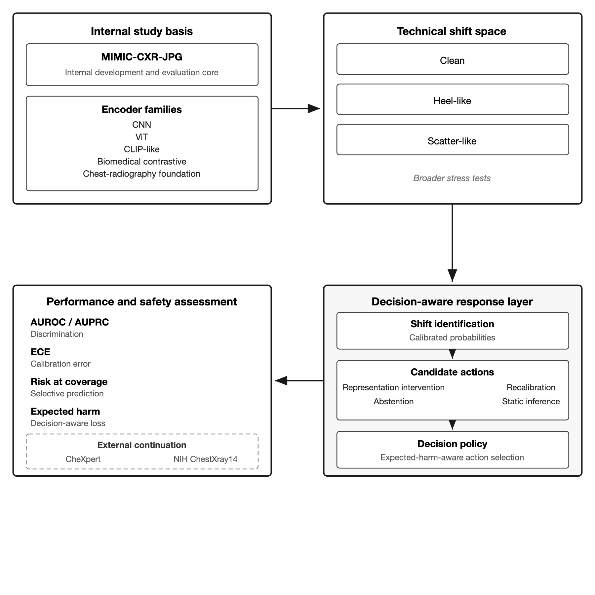

# PhysTTA

[](https://www.python.org/)
[](LICENSE)
[](https://doi.org/10.52167/1609-1817-2026-144-3-300-312)

PhysTTA is a research codebase for studying how chest X-ray models behave under acquisition and image-processing shifts. It combines controlled technical interventions, representation-level concept erasure, reliability metrics, calibration, fairness checks, and decision policies in one reproducible pipeline.

This repository is an ongoing research extension of the published study [*Reliability and Decision Support of Artificial Intelligence in Chest Radiography under Technical Image Shifts*](https://doi.org/10.52167/1609-1817-2026-144-3-300-312). It is not the exact archival code snapshot used for that publication.



## Research question

Can a model become less sensitive to technical acquisition conditions without losing clinically useful signal?

PhysTTA treats acquisition context as a measurable nuisance variable and evaluates four things together:

- invariance under controlled interventions;
- clean and worst-group clinical performance;
- underdiagnosis and calibration gaps;
- selective prediction, policy harm, and regret.

The controlled shifts are approximate image-space interventions for stress testing. They are not a substitute for real paired acquisitions or a claim of exact X-ray physics.

## What is included

- Deterministic technical-shift simulation and realism calibration.
- Linear, kernel, steering, and task-preserving representation erasers.
- Paired causal diagnostics and technical-pair quality gates.
- AUROC/AUPRC, calibration, fairness, selective-risk, and uncertainty metrics.
- Shift identification and decision-theoretic safety policies.
- Dataset adapters for MIMIC-CXR, CheXpert, NIH ChestX-ray14, PadChest, and VinDr-CXR metadata.
- Reproducibility manifests, artifact fingerprints, and frozen external evaluation.
- Unit, contract, and smoke tests for the public scientific core.

## Repository map

```text
phystta/
  causal/          paired estimands and confounding diagnostics
  data/            indexing, harmonization, DICOM checks, and splits
  intervention/    probes, erasers, online adaptation, and certificates
  metrics/         clinical, causal, calibration, fairness, and risk metrics
  models/          encoder factory and frozen-head contracts
  safety/          shift identification, recalibration, and policies
  shifts/          controlled interventions and realism calibration
  monitoring/      post-deployment shift-monitor simulation
scripts/           reproducible training and evaluation entrypoints
configs/           public, paper-tier, external, and model-family examples
tests/             scientific-core tests
```

The full data flow and artifact boundaries are documented in [docs/dataflow_map.md](docs/dataflow_map.md) and [docs/reprovenance_contract.md](docs/reprovenance_contract.md).

## Quick start

Create an environment with Python 3.10 or newer:

```bash
python -m venv .venv
source .venv/bin/activate
python -m pip install --upgrade pip
pip install -e ".[test]"
pytest
```

List the available pipeline entrypoints:

```bash
phystta list
```

Generate small test fixtures and preview the stages of the open-data pipeline. These commands are independent and neither downloads clinical data:

```bash
python scripts/make_minicxr_dataset.py --out_dir data/minicxr --n_patients 32
phystta run paper-suite -- \
  --config configs/representation_surgery_open.yaml \
  --eraser outputs/example/eraser.pt \
  --out_dir outputs/example/paper_suite \
  --dry_run
```

For model-family and VLM experiments, install the optional integrations:

```bash
pip install -e ".[full,test]"
```

## Public-data workflow

PhysTTA does not redistribute images or protected metadata. After obtaining a dataset under its own terms, normalize its metadata and build a deterministic index:

```bash
python scripts/prepare_open_cxr_metadata.py chexpert \
  --root /data/chexpert \
  --out /data/chexpert/metadata/chexpert_metadata.csv

python scripts/build_data_index.py \
  --config configs/representation_surgery_open.yaml \
  --out_csv data_indexes/open_cxr_index.csv \
  --set_config
```

Dataset capabilities and label harmonization rules are documented in [docs/public_dataset_capabilities.md](docs/public_dataset_capabilities.md) and [docs/external_label_harmonization.md](docs/external_label_harmonization.md).

## Reproducibility

- Patient-level grouping is required for train/calibration/test splits.
- Label columns are explicitly allow-listed; automatic label discovery is disabled.
- Shift application is deterministic for an image, shift type, intensity, and seed.
- Model, preprocessing, config, index, and eraser fingerprints are checked before evaluation.
- External evaluation is frozen: no threshold or policy retuning on the external set.
- Paper-tier configurations disable runtime downloads and require pinned local artifacts.

The container image uses a CUDA-enabled PyTorch base and the pinned [requirements.lock](requirements.lock):

```bash
docker build -t phystta .
docker run --rm phystta phystta list
```

## Scope and limitations

PhysTTA is research software, not a medical device. It must not be used for diagnosis, patient triage, or clinical decision-making. Performance depends on dataset access, label quality, model provenance, acquisition metadata, and site-specific validation. Simulated shifts should always be checked against real technical variability before conclusions are drawn.

Only load model, eraser, and policy artifacts that you created or obtained from a trusted source.

## Citation

If this repository supports your work, cite the related publication listed in [CITATION.cff](CITATION.cff):

> Dias Konyspayev, Batyrkhan Kuzenbayev, Nurlybay Abatov, and Dinara Alippayeva. “Reliability and Decision Support of Artificial Intelligence in Chest Radiography under Technical Image Shifts.” *Vestnik KazATK*, 2026. https://doi.org/10.52167/1609-1817-2026-144-3-300-312

## License

Code in this repository is available under the [MIT License](LICENSE). Datasets, model weights, and third-party assets remain subject to their original licenses and access agreements.
